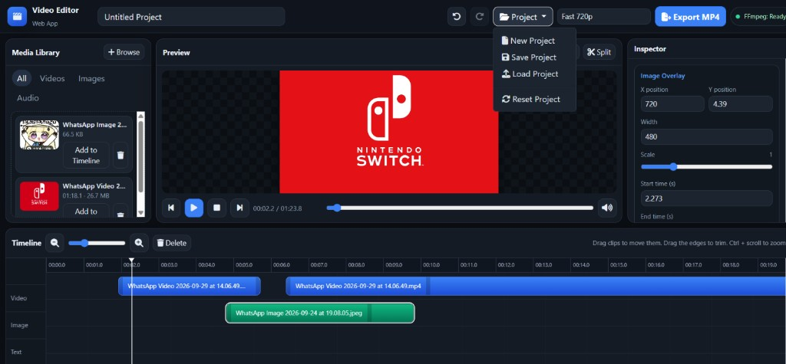
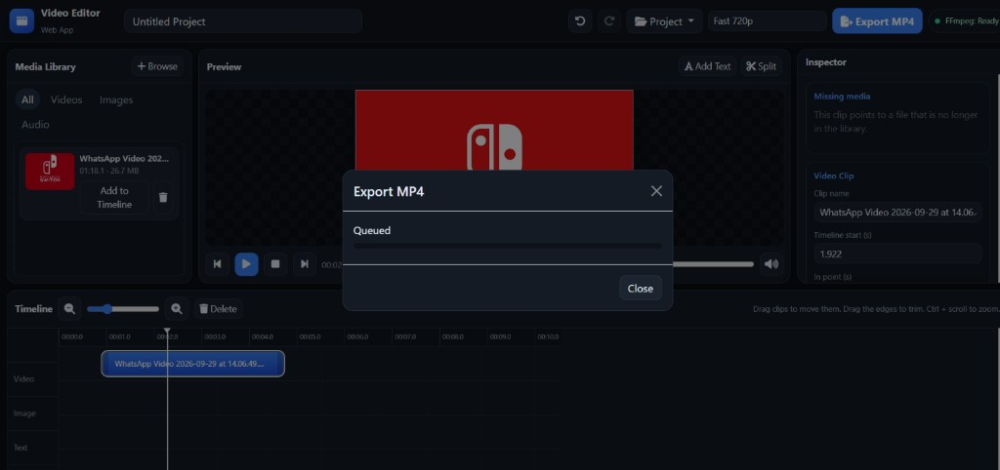

# Web-Based Video Editor

A browser-based video editor for learning PHP, HTML, CSS, JavaScript, and multimedia processing. Upload media, arrange it on a timeline, preview the composition, and export an MP4 with FFmpeg.

## Showcase

| Editor | Export |
| --- | --- |
|  |  |

## 1. Project overview

Open `index.php` in a browser served by Apache. The page is a desktop-style editor:

- Media library on the left
- Preview in the center
- Inspector on the right
- Timeline along the bottom

Projects are stored in the browser with LocalStorage. Uploaded files and finished MP4s are stored on the PHP server. MySQL is not required. The PHP includes are separated from the JavaScript modules so a database can be added later for accounts, saved projects, and export history.

## 2. Features

- Upload video, images, and audio with drag-and-drop, progress, and file checks
- Add clips to a video, image, text, or audio track
- Move, trim, delete, and split clips
- Change speed, volume, mute, position, scale, rotation, and crop
- Text overlays with common fonts, including Chinese fonts installed on Windows
- Background music mixed with the original video audio
- Brightness, contrast, saturation, grayscale, blur, and sepia
- Undo and redo (50 steps)
- New, save, load, and reset project
- Fast 720p and high-quality 1080p H.264 MP4 export with progress and download

## 3. Technologies

- PHP 8.3 or newer
- HTML5, CSS3, and vanilla JavaScript (ES modules)
- Bootstrap 5 and Font Awesome from CDN
- Fetch for API calls, and XMLHttpRequest for upload progress
- FFmpeg and FFprobe
- Browser LocalStorage
- Apache on XAMPP for local development, or cPanel hosting where FFmpeg is available

The project does not use Laravel, React, Vue, Node.js, jQuery, or Tailwind.

## 4. Requirements

- Windows for the XAMPP workflow in this guide
- XAMPP with Apache and PHP 8.3+
- FFmpeg and FFprobe
- A current desktop browser (Chrome or Edge)
- PHP extensions: `fileinfo`, `json`, `mbstring`
- `proc_open` must not be listed in `disable_functions`

## 5. XAMPP installation

1. Install XAMPP from https://www.apachefriends.org/ and start Apache from the XAMPP Control Panel.
2. Copy this project folder into `C:\xampp\htdocs\video-editor`.
3. Confirm the PHP version in XAMPP is 8.3 or newer (`C:\xampp\php\php.exe -v`).
4. Open http://localhost/video-editor/

Apache must allow `.htaccess` (`AllowOverride All` is the XAMPP default). The project uses those files to block PHP execution in `uploads/` and to hide `includes/`, `exports/`, `bin/`, and `storage/`.

## 6. FFmpeg installation

1. Download a current Windows build from https://www.gyan.dev/ffmpeg/builds/ (the essentials package is enough).
2. Either add the `bin` folder of that build to the system PATH, or copy `ffmpeg.exe` and `ffprobe.exe` into this project's `bin` folder.
3. You can also keep them in `C:\ffmpeg\bin\`. The application checks that location automatically.
4. Reload the editor. The header should show **FFmpeg: Ready**. Click the status pill to check again.

## 7. FFprobe installation

FFprobe is included in the same FFmpeg package. Copy `ffprobe.exe` next to `ffmpeg.exe`. The editor uses it to read duration, width, height, and whether a file has audio or video. Metadata is not created by re-encoding the upload.

## 8. Folder permissions

These folders must be writable by Apache:

- `uploads/` (videos, images, audio, thumbnails, previews, metadata)
- `exports/` (MP4 files and job folders)
- `storage/logs/`

On Windows with XAMPP, the user who starts Apache can usually write here. On Linux or cPanel, set the directories to `775` and the files to `644`. The application creates missing subfolders on the first API request.

## 9. PHP configuration

Edit the Apache `php.ini` (XAMPP: `C:\xampp\php\php.ini`):

```ini
upload_max_filesize = 512M
post_max_size = 512M
max_execution_time = 300
memory_limit = 512M
```

Restart Apache after saving. `proc_open` must be enabled. Leave `display_errors` off for normal use; technical errors are written to `storage/logs/`.

The CLI binary used for background export is detected automatically. If the header tooltip says PHP CLI was not found, set it explicitly (see the example below). On XAMPP this is usually `C:/xampp/php/php.exe`.

## 10. Upload limits

Default limits in `includes/config.php`:

| Media | Limit | Extensions |
| --- | --- | --- |
| Video | 500 MB | mp4, webm, mov, wmv |
| Image | 20 MB | jpg, jpeg, png, webp |
| Audio | 50 MB | mp3, wav, aac, m4a |

The server checks the extension, the detected MIME type, the size, and the temporary upload path. Video and audio are accepted only after FFprobe confirms a real media stream. Images must pass `getimagesize`. Files are stored under a random id, never under the original filename.

`post_max_size` and `upload_max_filesize` must be at least as large as the video limit, or PHP will reject the upload before this application sees it.

## 11. How to start the application

1. Start Apache in XAMPP.
2. Open http://localhost/video-editor/ (or the folder name you used).
3. Confirm **FFmpeg: Ready**.
4. Enter a project name. The default canvas is 1920×1080 at 30 fps.
5. Upload media and click **Add to Timeline**, or drag an item onto the matching track.

The editor saves the project in LocalStorage after each change. **Save Project** also downloads a JSON file. **Load Project** reads that file back.

## 12. How to export a video

1. Add at least one video, image, or text element.
2. Choose **Fast 720p** or **High Quality 1080p**.
3. Click **Export MP4**.
4. The browser sends the project JSON to `api/export.php`.
5. PHP starts `api/export_worker.php` in the background and returns immediately.
6. The page polls `api/export_status.php` and shows status (`queued`, `running`, `done`, or `error`), percent, and elapsed time.
7. When the job is done, click **Download MP4**.

Fast export uses 1280×720, H.264, AAC, and a faster preset. High quality uses 1920×1080, H.264, AAC, and a slower preset. Both use `yuv420p` and `+faststart`.

The worker builds an FFmpeg filter graph from the project: trim, speed, crop, scale, rotation, overlays, text, color adjustments, and audio mixing. It does not render one fixed sample video.

## 13. Troubleshooting

| Message | What to do |
| --- | --- |
| FFmpeg: Not Available | Install FFmpeg and FFprobe, then click the status pill. |
| FFprobe is unavailable | Copy `ffprobe.exe` into `bin/` or PATH. |
| PHP CLI was not found | Set `php_cli` in `includes/config.local.php`. |
| File is too large | Raise `upload_max_filesize` and `post_max_size`, then restart Apache. |
| Unsupported file type | Use one of the extensions listed above. |
| Media could not be analysed | The file extension does not match a real video or audio stream. |
| Add at least one video, image, or text element | The timeline has nothing to render. |
| Invalid project data | The JSON is damaged or a trim is shorter than 0.1 seconds. |
| Missing media | A timeline item points at a file that was deleted from the library. |
| Export failed | Open `storage/logs/app.log`. The page itself does not show server paths. |
| Upload folder is not writable | Give Apache write access to `uploads/` and `exports/`. |
| Preview unavailable | WMV/MOV files get a browser-friendly proxy when FFmpeg can make one. Export still uses the original file. |

WMV and some MOV files cannot play in the browser until a preview proxy is created. If proxy creation fails, the clip can still be exported.

## 14. cPanel deployment

1. Upload the project above the public web root if you can, or keep `uploads/` and `exports/` protected by the included `.htaccess` files.
2. Set the domain or subdomain document root to the project folder.
3. Confirm the host provides PHP 8.3+ and a working `ffmpeg` / `ffprobe` on the command line.
4. Set `ffmpeg_path` and `ffprobe_path` in `includes/config.local.php` if they are not on PATH.
5. Set `php_cli` to the host's `php` binary so export jobs can run in the background.
6. Make `uploads/`, `exports/`, and `storage/` writable.
7. Raise PHP upload limits in MultiPHP INI Editor or `php.ini`.
8. Do not expose `includes/config.local.php`, logs, or the `bin/` folder. The `.htaccess` rules deny those paths on Apache.

Shared hosts that disable `proc_open` cannot run FFmpeg. Choose a host that allows it.

## 15. Security considerations

- Original filenames are display text only. Stored names are random ids.
- Extension, MIME type, size, and media headers are all checked.
- Paths are resolved inside `uploads/` and rejected if they escape that directory.
- FFmpeg is started with an argument list, not by concatenating raw user text into a shell command.
- Filter text is written to files. Font files come from a fixed list.
- API responses are JSON. Errors shown in the browser do not include filesystem paths, `php.ini` values, or the raw FFmpeg command.
- `exports/` is not browsable. Downloads go through `api/download.php` for finished jobs only.
- PHP execution is disabled inside `uploads/`.

This build has no accounts. Anyone who can open the site can upload and export. Add authentication before putting it on a public server.

## Example configuration

Copy `includes/config.local.php.example` to `includes/config.local.php`:

```php
<?php
declare(strict_types=1);

return [
    'ffmpeg_path' => 'C:/ffmpeg/bin/ffmpeg.exe',
    'ffprobe_path' => 'C:/ffmpeg/bin/ffprobe.exe',
    'php_cli' => 'C:/xampp/php/php.exe',
    'max_video_size' => 500 * 1024 * 1024,
    'max_image_size' => 20 * 1024 * 1024,
    'max_audio_size' => 50 * 1024 * 1024,
    'composition_width' => 1920,
    'composition_height' => 1080,
    'composition_fps' => 30,
];
```

Leave a path empty to use automatic detection.

## Project layout

```text
index.php
api/                 upload, media, export, export status, health, download
assets/css/editor.css
assets/js/           editor modules
includes/            config, validation, FFmpeg, export jobs
uploads/             media files (created at runtime)
exports/             MP4 output and job state
bin/                 optional ffmpeg.exe and ffprobe.exe
storage/logs/        server logs
```

## API

All JSON APIs return `{ "ok": true|false, "message": "...", ... }`.

- `POST api/upload.php` with `files[]`
- `GET api/media.php` lists the library
- `POST api/media.php` with `{ "action": "delete", "id": "..." }`
- `POST api/export.php` with the project JSON
- `GET api/export_status.php?job=...`
- `GET api/health.php`
- `GET api/download.php?job=...`

## Adding MySQL later

Keep the project JSON shape. A future table can store `users`, `projects` (`id`, `user_id`, `name`, `data` JSON), and `exports`. Use PDO with prepared statements and `utf8mb4`. Do not build SQL by concatenating request values. The editor already sends and validates that JSON on the server, so the database layer only has to save and load it.

## Keyboard shortcuts

- Space: play or pause
- Ctrl+Z / Ctrl+Y: undo or redo
- Ctrl+S: save a JSON copy
- S: split the selected video at the playhead
- Delete: remove the selected clip
- Home / End: jump to the start or end
